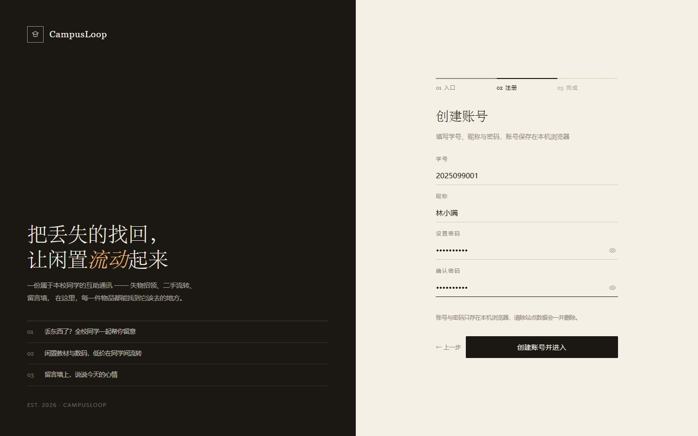
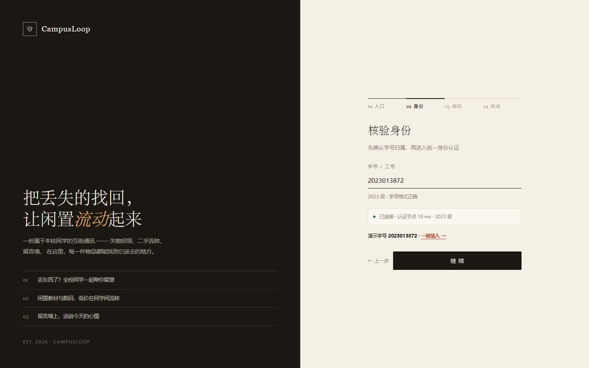
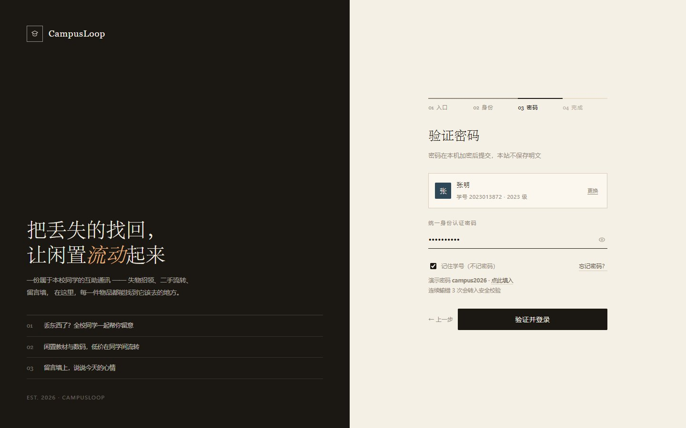
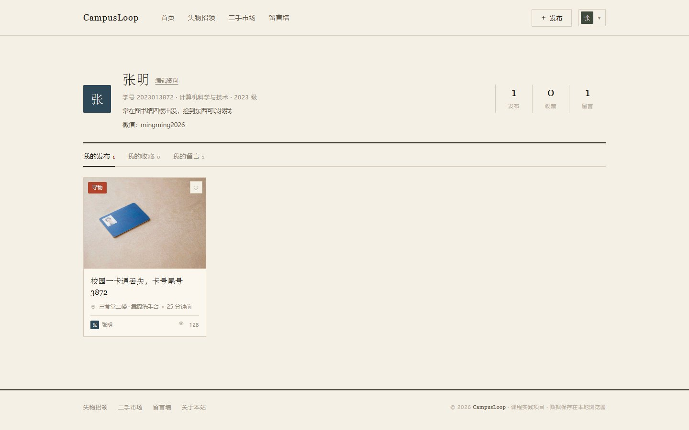
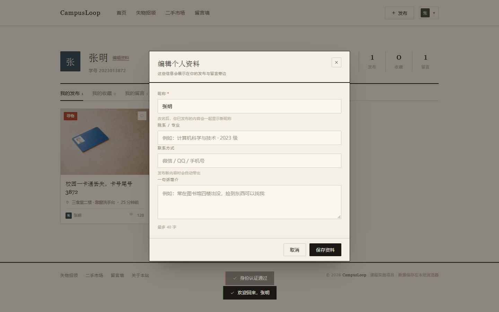

# CampusLoop

> VibeCoding 实战 · 小组作业
>   
> 一个纯前端的校园信息互助平台：**失物招领 / 二手市场 / 留言墙** 三合一。

**在线预览**：<https://espoirdre.github.io/CampusLoop/>  
**代码仓库**：<https://github.com/Espoirdre/CampusLoop>


手机扫码直接打开，建议在浏览器菜单里「添加到主屏幕」，用起来跟 App 差不多。

也可以在电脑上双击 `index.html`，不需要安装任何依赖、不需要后端服务。

> **关于数据**：这是纯前端演示版，发布的内容存在各自浏览器的 `localStorage` 里，
> 换设备、换浏览器、清理缓存都会看不到，同学之间也不互通。
> 想让多人共用一套数据，需要接云端数据库（见「下一步可以做」）。


---

## 一、这是什么

同学丢东西要在十几个群里刷屏，闲置教材只能在朋友圈发一条，想找搭子又没有合适的地方。

这个项目把这三件事收进一个站点：**丢了东西发寻物启事，捡到东西发招领公告；闲置物品低价流转；留言墙上说两句今天的心情。**

界面走的是**编辑杂志风**——米白纸感底色、衬线大标题、细线分隔、朱红点缀。刻意避开了常见的「渐变 + 圆角大卡片 + emoji 图标」，因为那套视觉一眼就能看出是模板生成的。

---

## 二、功能清单

### 失物招领

- 「寻物启事 / 失物招领」双 Tab，带数量徽标
- 7 个物品分类：证件卡类、电子产品、书籍资料、钥匙、衣物饰品、生活用品、其他
- 关键词搜索（标题 / 描述 / 地点）、按最新或浏览量排序
- 状态管理：进行中 / 已完结，自己发布的可一键标记「已找回」
- 详情弹窗左右分栏展示，联系方式默认打码，点击才显示并可复制

### 二手市场

- 完整字段：价格、原价（自动算折扣）、成色、分类、交易方式、图片、描述
- 「全部 / 在售 / 已售出」三种视图
- 6 个商品分类筛选 + 关键词搜索 + 四种排序（最新 / 价格升降 / 最热）
- 「我想要」：记录意向人数，卖家能看到有多少人感兴趣
- 自己发布的可标记「已售出」，售出后卡片自动降饱和

### 留言墙

- 纸质便签瀑布流，7 种纸张色可选，卡片带轻微随机旋转
- 点赞、回复（楼中楼），支持「最新 / 最热」排序
- 发帖上限 140 字

### 通用

- **两个登录入口**：进入登录页先选「注册新账号」或「统一身份认证」
  - **注册**：填学号、昵称、密码（两次确认）→ 直接建档并进站，账号存在本机浏览器
  - **统一身份认证**：核验学号（位数 / 年份校验 + 节点连通性探测）→ 验证密码 → 安全校验（连续 3 次密码错误转人机校验，可网页登录兜底）→ 确认昵称，每步可回退
- **账号真校验**：学号不在白名单且未注册 → 学号步就拦下；密码不符 → 提示剩余次数并计数；注册账号的密码以散列存储，不写明文
- **个人资料**：可改昵称、院系专业、联系方式、一句话简介；改名会同步到已发布内容，联系方式在发布时自动带出
- 密码只在当次登录使用，不落盘；「记住我」只记住学号与昵称
- 个人中心：我的发布 / 我的收藏 / 我的留言
- 收藏、发布、删除、状态切换均有本地持久化
- 图片上传自动压缩（最长边 900px，JPEG 72%）后存本地
- 全站响应式，手机端为双列卡片 + 两行导航

---

## 三、截图

| 登录入口（二选一） | 注册新账号 |
| --- | --- |
|  |  |

| 失物招领 | 二手市场 |
| --- | --- |
|  |  |

| 信息详情（左右分栏） | 留言墙 |
| --- | --- |
|  |  |

| 认证向导 · 核验身份 | 认证向导 · 验证密码 |
| --- | --- |
|  |  |

| 个人中心（可编辑资料） | 编辑资料弹窗 |
| --- | --- |
|  |  |

| 发布表单 | 移动端 |
| --- | --- |
|  |  |

---

## 四、怎么跑起来

**方式一（最简单）**：双击 `index.html`，浏览器直接打开。

**方式二（本地服务器，推荐）**：

```bash
# 在项目根目录执行，任选其一
python -m http.server 8000
npx serve .
```

然后访问 `http://localhost:8000`。

> 两种方式都能正常使用，数据存在浏览器的 `localStorage` 里，不会上传到任何服务器。
>   
> 想清空数据重新开始：浏览器控制台执行 `localStorage.removeItem('campusloop_v1')` 后刷新。

### 演示账号

纯前端接不了学校真实认证，所以内置了一份本地账号白名单。**统一密码 `campus2026`**，学号任意一个都行：

| 学号 | 姓名 | 备注 |
| --- | --- | --- |
| `2023013872` | 张明 | 有历史发布与留言，适合演示「我的发布」 |
| `2024021183` | 李雨桐 | 招领信息作者 |
| `2022036621` | 陈嘉豪 | 二手买家 / 留言墙活跃 |
| `2021010234` | 周子涵 | 卖 iPad 的那位 |

完整名单在 `index.html` 的 `ACCOUNTS` 数组里，共 15 个。进入「统一身份认证」后点「一键填入」会自动填好学号与演示密码。

不想用演示账号，也可以走「注册新账号」自己建一个：填 10 位学号、2–12 字昵称、6–20 位密码，提交后直接进站。注册的账号会写进 `localStorage` 的 `accounts` 字段，密码只存散列，不存明文；下次从「统一身份认证」入口输入同一学号与密码即可登录。

想看拦截效果：学号随便改一位 → 学号步就提示「该学号没有认证记录」，并给一条「改用注册」的入口；密码故意输错 3 次 → 转入人机校验。注册时若填了已在白名单里的学号，会被提示改用统一认证。

---

## 五、技术实现

刻意选了最朴素的方案：**一个 HTML 文件 + 原生 JS，零依赖、零构建**。

| 关注点   | 做法                                                      |
| ----- | ------------------------------------------------------- |
| 数据存储  | `localStorage`，key 为 `campusloop_v1`，带版本号               |
| 数据层封装 | 所有读写集中在 `Store.read / Store.write`，换成云端接口只需改这两个方法       |
| 页面切换  | 单页应用，五个 view 节点切换显隐，无路由库                                |
| 事件绑定  | document 事件委托 + `data-act` 属性分发，避免动态渲染后重复绑事件            |
| 搜索体验  | 输入时只局部重渲染列表容器，输入框不重建，所以不会失焦                             |
| 图片处理  | `<canvas>` 压缩后转 base64 存入 localStorage，超配额时降级到内存并提示     |
| 图标    | 自绘 24 个 1.4px 线性 SVG 图标，不用 emoji、不引图标库                  |
| 字体    | 标题 Georgia / 宋体衬线，正文系统黑体——小字号宋体在 Windows 上发虚，所以只在大标题用衬线 |
| 响应式   | 1080 / 900 / 520 三档断点，手机端导航折成两行避免挤压                     |

### 目录结构

```
.
├── index.html              # 整站（HTML + CSS + JS 全在这一个文件里）
├── assets/                 # 演示用物品图片（8 张）
│   ├── card.jpg            #   校园卡
│   ├── thermos.jpg         #   保温杯
│   ├── keys.jpg            #   钥匙串
│   ├── books.jpg           #   教材
│   ├── tablet.jpg          #   平板
│   ├── keyboard.jpg        #   机械键盘
│   ├── fridge.jpg          #   迷你冰箱
│   └── basketball.jpg      #   篮球
├── docs/screenshots/       # README 用截图
├── CHANGELOG.md            # 版本改动记录
└── README.md
```

---

## 六、已知取舍

- **没有真实后端**：数据只存在当前浏览器，换电脑就看不到自己的发布。这是课程演示阶段的刻意选择，数据层已经留好升级口。
- **登录不接真实认证**：纯前端没法对接学校 iAAA。统一认证入口走本地白名单（`ACCOUNTS` + 统一密码），注册入口把账号写在本机 `localStorage`。向导里的「节点探测」「人机校验」是模拟的，但学号存在性、密码正确性、注册时的重名与格式都会真的拦。
- **注册账号只在本机有效**：换浏览器或清除站点数据后就没了；密码用 64 位散列存储，能避免明文直存，但不是密码学安全的哈希，别用真实密码。
- **图片存 base64**：浏览器 localStorage 约 5MB，所以上传图被压到 900px。真要上线应该换成对象存储。

---

## 七、下一步可以做

- [ ] 接入云端数据库（Supabase / 微信云开发），实现真正的多人共享
- [ ] 站内私信，替代「加微信」的第一步
- [ ] 智能匹配：发布寻物启事时自动推荐相似招领信息
- [ ] 管理员后台：审核、下架、举报处理

---

## 八、版本管理

每一次改动都会留下一条 git 记录，谁改的、改了什么、哪一行变了都能查到。

### 日常提交

```bash
git add -A
git commit -m "feat: 新增智能匹配推荐"
git push
```

提交信息建议用前缀标明类型，方便回看：

| 前缀          | 含义      |
| ----------- | ------- |
| `feat:`     | 新功能     |
| `fix:`      | 修 bug   |
| `style:`    | 只改视觉样式  |
| `refactor:` | 重构，不改功能 |
| `docs:`     | 文档      |

### 查看历史

```bash
git log --oneline            # 所有版本，一行一条
git log -p                   # 连改动内容一起看
git show <commit-id>         # 看某一次提交
git diff v1.0.0 HEAD         # 和某个版本对比
```

GitHub 上更直观：仓库首页点 `Commits` 看全部提交，点进任意一条就是逐行 diff。

### 打版本号

```bash
git tag -a v1.1.0 -m "新增私信功能"
git push origin v1.1.0
```

打过的标签会出现在 GitHub 的 `Releases` / `Tags` 里，老师一眼能看到迭代节奏。

### 推送失败时

远程用的是 SSH（`git@github.com:Espoirdre/CampusLoop.git`）。如果提示 `Permission denied (publickey)`，先验证密钥：

```bash
ssh -T git@github.com
```

本机 `~/.ssh/config` 已配置走 `ssh.github.com:443`，所以不需要开代理也能推。
