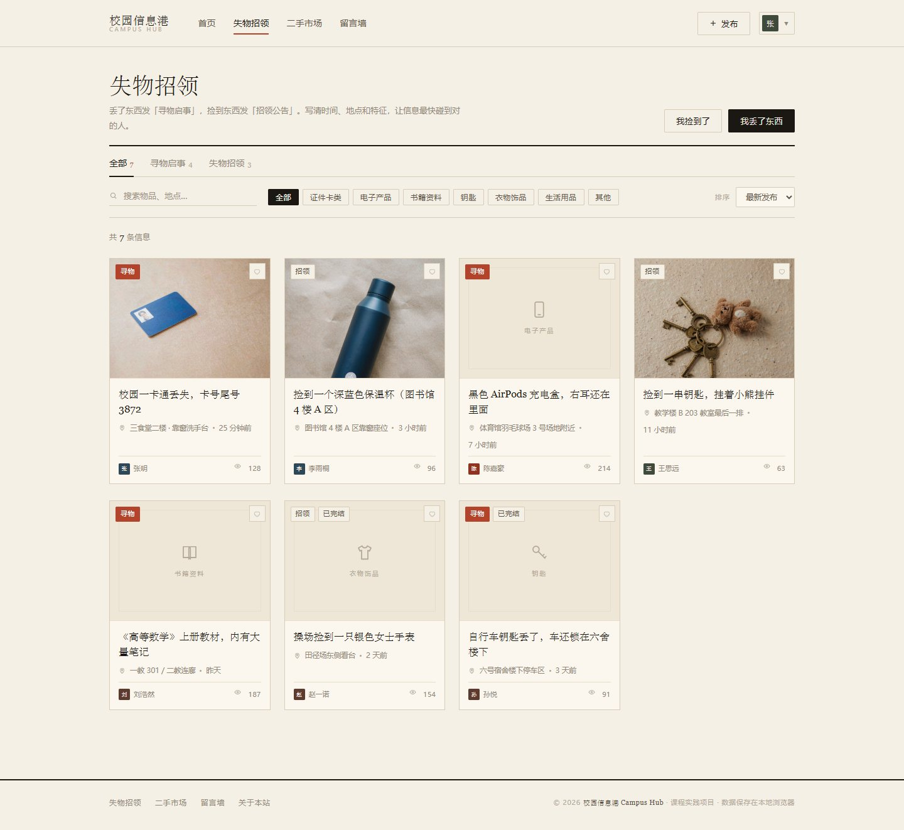
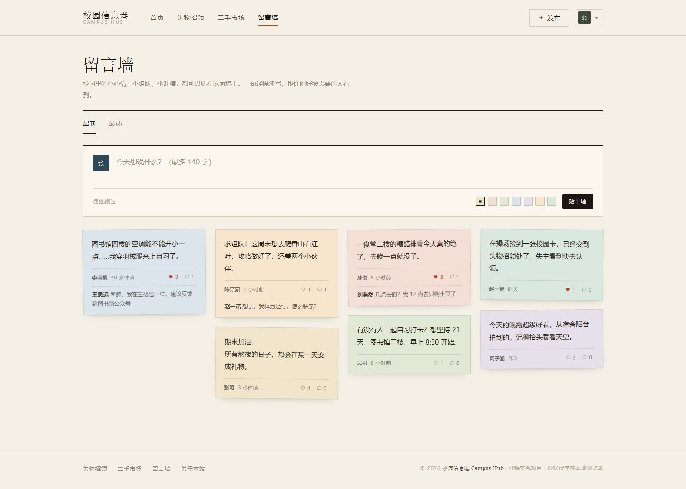
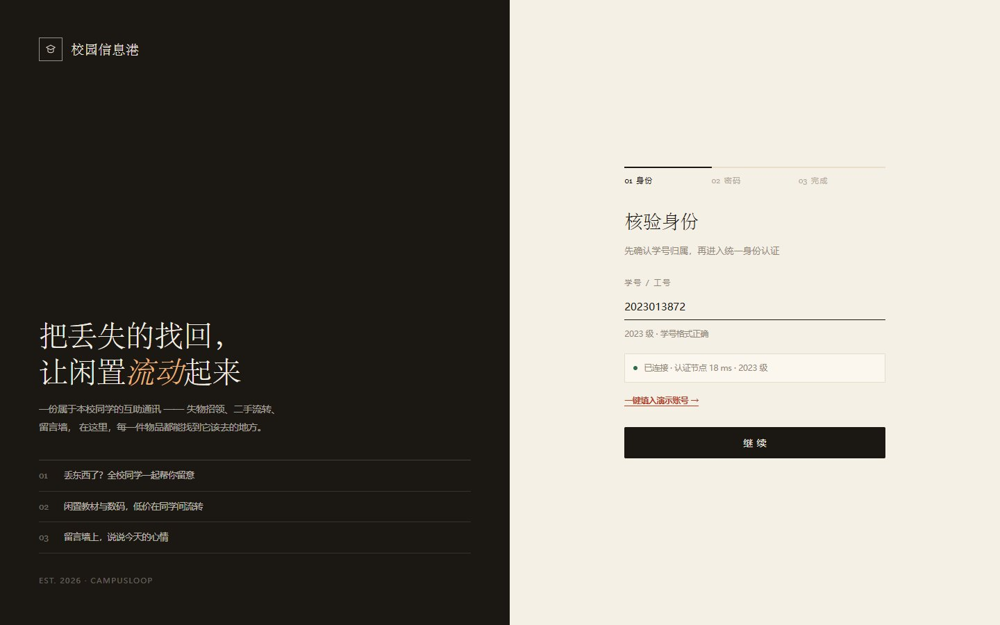
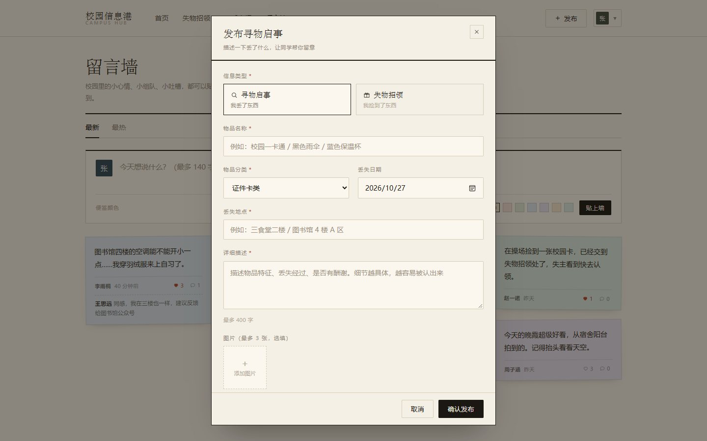
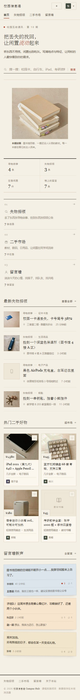

# CampusLoop · 校园信息港

> VibeCoding 实战 · 小组作业
> 一个纯前端的校园信息互助平台：**失物招领 / 二手市场 / 留言墙** 三合一。

**在线预览**：<https://espoirdre.github.io/CampusLoop/>
**代码仓库**：<https://github.com/Espoirdre/CampusLoop>

打开 `index.html` 就能用，不需要安装任何依赖、不需要后端服务。


---

## 一、这是什么

同学丢东西要在十几个群里刷屏，闲置教材只能在朋友圈发一条，想找搭子又没有合适的地方。

这个项目把这三件事收进一个站点：**丢了东西发寻物启事，捡到东西发招领公告；闲置物品低价流转；留言墙上说两句今天的心情。**

界面走的是**编辑杂志风**——米白纸感底色、衬线大标题、细线分隔、朱红点缀。刻意避开了常见的「渐变 + 圆角大卡片 + emoji 图标」，因为那套视觉一眼就能看出是模板生成的。

---

## 二、功能清单

### 失物招领
- 「寻物启事 / 失物招领」双 Tab，带数量徽标
- 7 个物品分类：证件卡类、电子产品、书籍资料、钥匙、衣物饰品、生活用品、其他
- 关键词搜索（标题 / 描述 / 地点）、按最新或浏览量排序
- 状态管理：进行中 / 已完结，自己发布的可一键标记「已找回」
- 详情弹窗左右分栏展示，联系方式默认打码，点击才显示并可复制

### 二手市场
- 完整字段：价格、原价（自动算折扣）、成色、分类、交易方式、图片、描述
- 「全部 / 在售 / 已售出」三种视图
- 6 个商品分类筛选 + 关键词搜索 + 四种排序（最新 / 价格升降 / 最热）
- 「我想要」：记录意向人数，卖家能看到有多少人感兴趣
- 自己发布的可标记「已售出」，售出后卡片自动降饱和

### 留言墙
- 纸质便签瀑布流，7 种纸张色可选，卡片带轻微随机旋转
- 点赞、回复（楼中楼），支持「最新 / 最热」排序
- 发帖上限 140 字

### 通用
- 仿学校统一身份认证登录页（演示版，任意学号可进；输入 `2023013872` 会变成种子用户「张明」，能看到他的历史发布）
- 个人中心：我的发布 / 我的收藏 / 我的留言
- 收藏、发布、删除、状态切换均有本地持久化
- 图片上传自动压缩（最长边 900px，JPEG 72%）后存本地
- 全站响应式，手机端为双列卡片 + 两行导航

---

## 三、截图

| 失物招领 | 二手市场 |
| --- | --- |
|  |  |

| 信息详情（左右分栏） | 留言墙 |
| --- | --- |
|  |  |

| 登录页 | 发布表单 |
| --- | --- |
|  |  |

移动端：

---

## 四、怎么跑起来

**方式一（最简单）**：双击 `index.html`，浏览器直接打开。

**方式二（本地服务器，推荐）**：

```bash
# 在项目根目录执行，任选其一
python -m http.server 8000
npx serve .
```

然后访问 `http://localhost:8000`。

> 两种方式都能正常使用，数据存在浏览器的 `localStorage` 里，不会上传到任何服务器。
> 想清空数据重新开始：浏览器控制台执行 `localStorage.removeItem('campusloop_v1')` 后刷新。

---

## 五、技术实现

刻意选了最朴素的方案：**一个 HTML 文件 + 原生 JS，零依赖、零构建**。

| 关注点 | 做法 |
| --- | --- |
| 数据存储 | `localStorage`，key 为 `campusloop_v1`，带版本号 |
| 数据层封装 | 所有读写集中在 `Store.read / Store.write`，换成云端接口只需改这两个方法 |
| 页面切换 | 单页应用，五个 view 节点切换显隐，无路由库 |
| 事件绑定 | document 事件委托 + `data-act` 属性分发，避免动态渲染后重复绑事件 |
| 搜索体验 | 输入时只局部重渲染列表容器，输入框不重建，所以不会失焦 |
| 图片处理 | `<canvas>` 压缩后转 base64 存入 localStorage，超配额时降级到内存并提示 |
| 图标 | 自绘 24 个 1.4px 线性 SVG 图标，不用 emoji、不引图标库 |
| 字体 | 标题 Georgia / 宋体衬线，正文系统黑体——小字号宋体在 Windows 上发虚，所以只在大标题用衬线 |
| 响应式 | 1080 / 900 / 520 三档断点，手机端导航折成两行避免挤压 |

### 目录结构

```
.
├── index.html              # 整站（HTML + CSS + JS 全在这一个文件里）
├── assets/                 # 演示用物品图片（8 张）
│   ├── card.jpg            #   校园卡
│   ├── thermos.jpg         #   保温杯
│   ├── keys.jpg            #   钥匙串
│   ├── books.jpg           #   教材
│   ├── tablet.jpg          #   平板
│   ├── keyboard.jpg        #   机械键盘
│   ├── fridge.jpg          #   迷你冰箱
│   └── basketball.jpg      #   篮球
├── docs/screenshots/       # README 用截图
├── CHANGELOG.md            # 版本改动记录
└── README.md
```

---

## 六、已知取舍

- **没有真实后端**：数据只存在当前浏览器，换电脑就看不到自己的发布。这是课程演示阶段的刻意选择，数据层已经留好升级口。
- **登录不校验密码**：纯前端没法对接学校真实认证，页面只复刻了统一认证的交互流程。
- **图片存 base64**：浏览器 localStorage 约 5MB，所以上传图被压到 900px。真要上线应该换成对象存储。

---

## 七、下一步可以做

- [ ] 接入云端数据库（Supabase / 微信云开发），实现真正的多人共享
- [ ] 站内私信，替代「加微信」的第一步
- [ ] 智能匹配：发布寻物启事时自动推荐相似招领信息
- [ ] 管理员后台：审核、下架、举报处理
